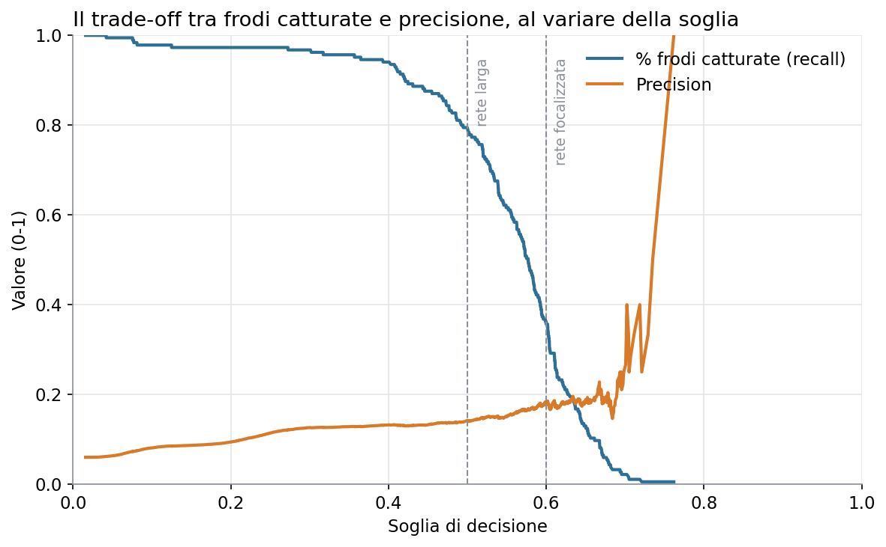
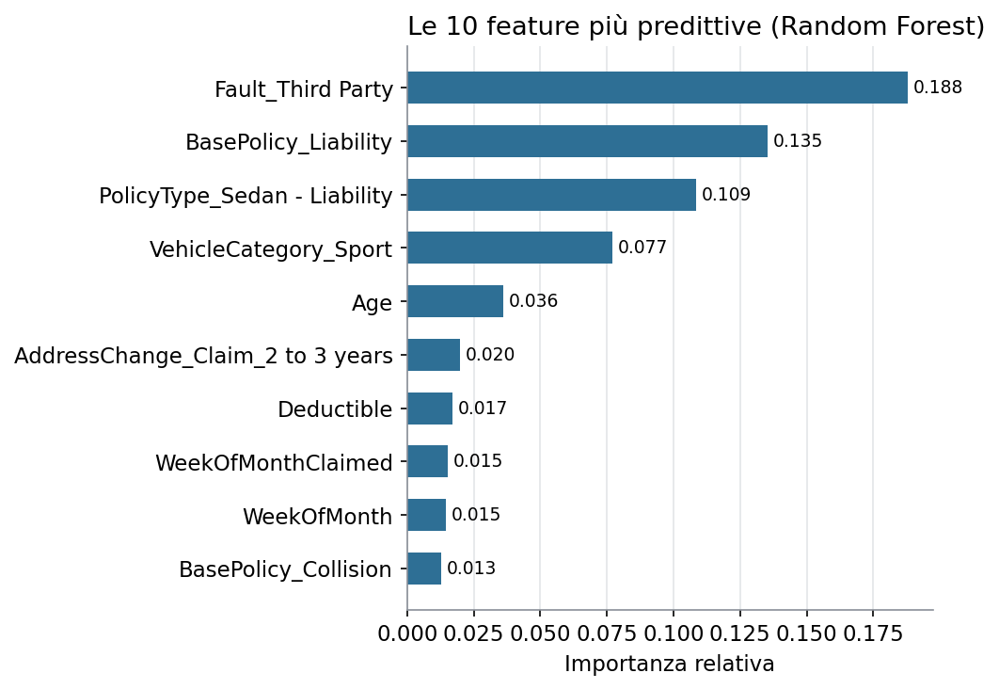

Un progetto che unisce due prospettive: quella del **data scientist** (qual è il modello più robusto su una classe rara?) e quella del **product manager** (come diventa uno strumento che un team antifrode userebbe davvero?).

## La domanda

È possibile assegnare un punteggio di rischio frode a ogni sinistro appena denunciato, abbastanza affidabile da alimentare una coda di revisione, senza sommergere gli investigatori di falsi positivi?

## Come l'ho affrontato

- **Dati:** 15.420 sinistri auto, con solo il 6% di casi fraudolenti.
- **Architettura a livelli (bronze, silver, gold):** dato grezzo, dato pulito e tabelle pronte per il modello e per i KPI di prodotto.
- **Modelli:** Logistic Regression come baseline e Random Forest come candidato finale, con bilanciamento delle classi.
- **Metriche:** precision, recall e PR-AUC, perché con una classe al 6% l'accuratezza da sola è fuorviante.

## Cosa ho trovato

Il Random Forest è risultato il modello più robusto (PR-AUC 0.170 contro 0.161) e più stabile alle soglie alte. Il punto interessante è il trade-off sulla soglia: a 0.50 si intercetta il 78.9% delle frodi segnalando un sinistro su tre; a 0.60 il carico scende a circa uno su dieci, ma si cattura solo il 35.7% delle frodi.

Per questo il risultato è una **coda di triage con soglia configurabile** e non un sistema di blocco automatico: la scelta della soglia è una decisione di prodotto, non solo tecnica.

## Limiti dichiarati

Un solo split train/test senza cross-validation, dati storici di un solo mercato e nessun importo del sinistro in valuta. Sono tutti documentati nel repository, insieme agli sviluppi futuri (SMOTE, raggruppamento delle categorie rare).

Il [repository](https://github.com/ntnchr11/insurance-fraud-triage) contiene pipeline, analisi, grafici e il PRD del prodotto.
